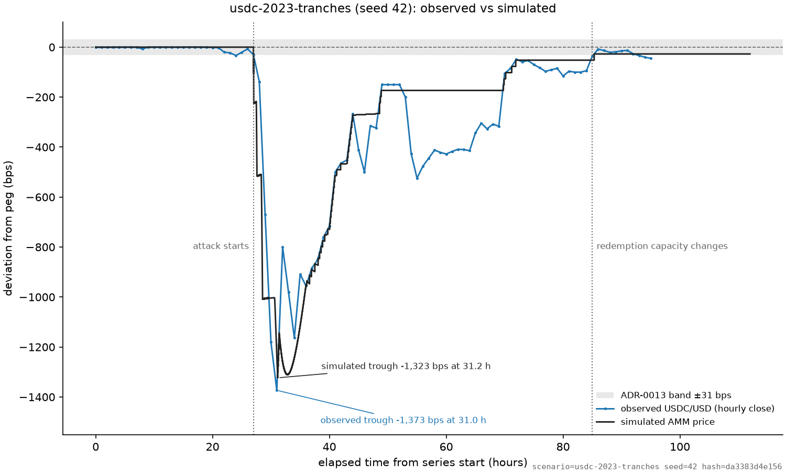
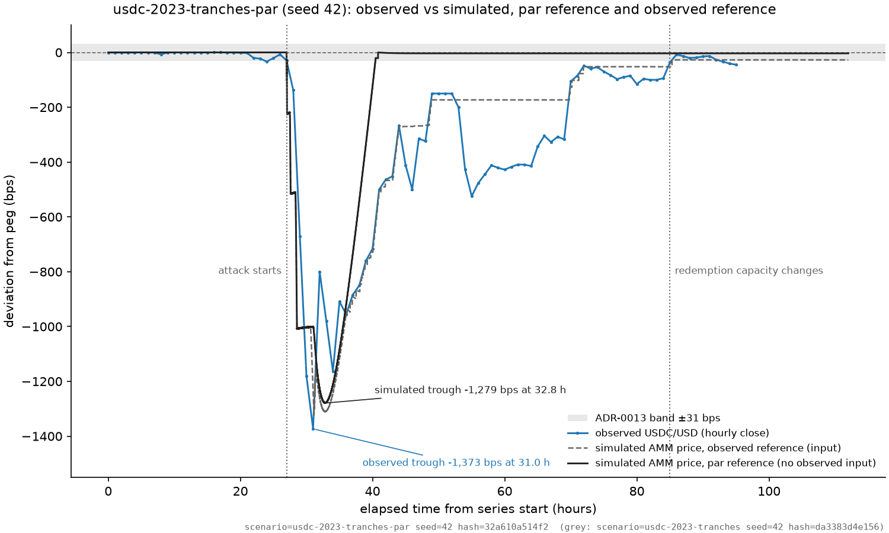
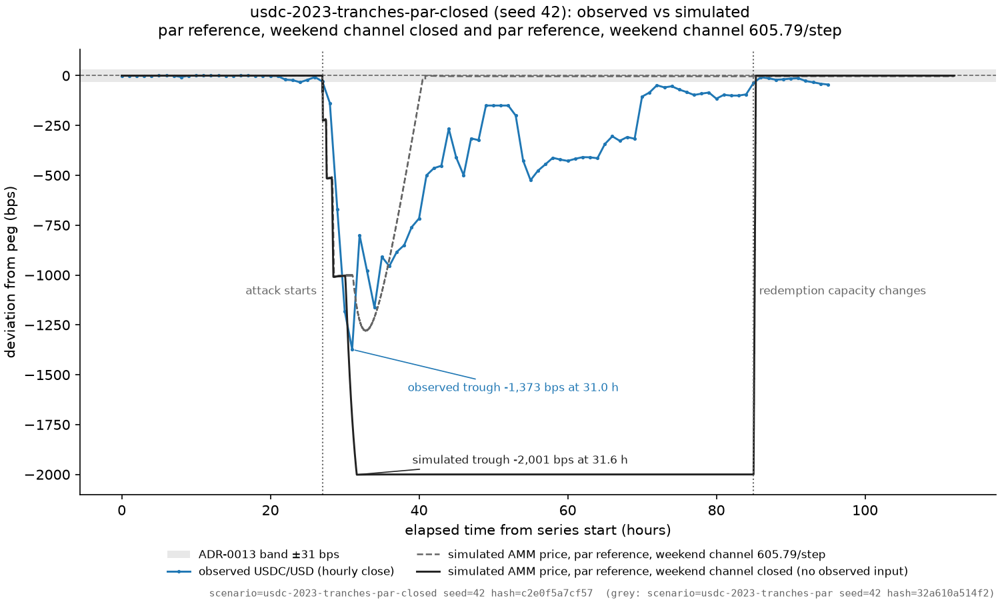
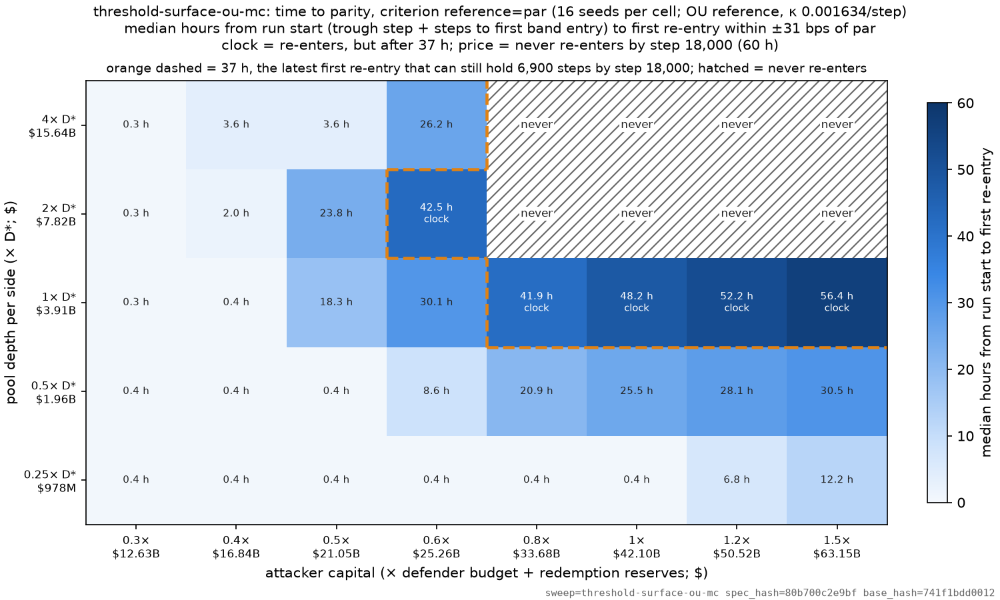
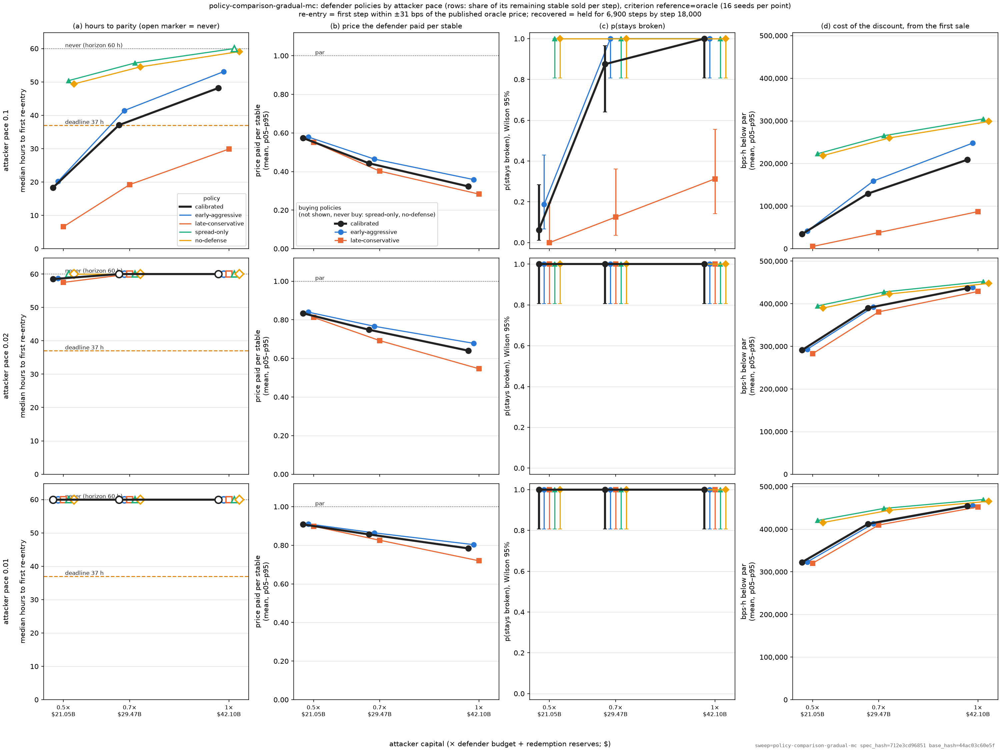

# What breaks a peg: a stablecoin under attack, and where the 1992 analogy ends

**Corposium Research · draft v2.0 · 2026-10-17 · code frozen at `v0.95-freeze`**

*A deterministic simulator of a stablecoin under selling pressure, calibrated to public
Curve, Chainlink and Circle figures, replayed against USDC's March 2023 depeg. Every number
regenerates from one command.*

---

## Abstract

We built a small agent-based simulator of a stablecoin whose price is set in an automated
market maker and whose issuer redeems at par through a capacity-limited channel, and asked
of it the question the 1992 sterling crisis asks of any pegged price: under what
combination of liquidity, selling pressure, resources and defense policy does the promise
fail? Calibrated to public parameters and replayed against the USDC weekend of March 2023,
the model first fell four times too far. It reproduces the observed trough within 10% once
a ladder of buyers who expect redemption at par is added, and it does so with nothing from
the observed price series fed in. It does not reproduce the two days the price stayed
below par, and the reason it cannot is a finding: in the model belief is a switch; that
weekend it was a process.

Four other things the model shows, each with its condition. At issuer scale the binding
constraint in these experiments is the redemption channel's throughput, not the reserves.
Deep liquidity protects the price and raises the cost of defending it. At matched scale a
patient attacker beats every rule-based defender we tried. And on-chain the two exits are
separate channels, with the issuer's exit a queue: a large redeemer crowds out the
arbitrage that would have restored the price. Where the chain stops looking like 1992 is
where the model earns its keep. The code, every parameter's source, every fit's record
and every figure's regenerating command are public.

---

## 1. The question

A peg is a price promise. On 16 September 1992 the British government spent reserves,
raised the base rate from 10% to 12%, announced 15%, and gave up by evening. The standard
account is that the promise exceeded the political will to keep paying for it once the
market stopped believing. Behind that account sits a literature — reserve-exhaustion
models, self-fulfilling-crisis models, bank-run models — and a question that applies to
any pegged price: what breaks it?

Stablecoins are pegs. They have an issuer with reserves, a redemption promise, venues
where the price is set, and sellers with capital. They also have things 1992 did not: an
automated market maker whose price impact is a formula, an oracle, a redemption channel
with a throughput limit and a queue, and reserves that are attested rather than secret.

This project started from 1992 and built the smallest model that contains those parts.
The analogy gave the model its question, its cast and its first calibration. It did not
survive as an explanation: the model does not explain Black Wednesday, and we stopped
asking it to. What it does is show, mechanically, how an on-chain peg behaves under
pressure — and the places where that behaviour has no 1992 counterpart turned out to be
the results worth publishing. Section 8 collects them.

## 2. The model in one page

A discrete-step model, 12 seconds per step, nine ordered phases per step, versioned.
One seed and one scenario file produce byte-identical output.

**Venue.** A constant-product pool of stablecoin against a reference asset, with a fee on
input. Its spot price is the stablecoin's price. One pool stands in for every venue.
(Curve's 3pool uses the StableSwap invariant, which is flatter near par than constant
product; the pool depth fitted below absorbs part of that difference and is reported as a
calibration, not a measurement.)

**Oracle.** Publishes the reference price on a deviation threshold or a heartbeat, as
Chainlink does.

**Redemption.** The issuer pays par, less a spread, from reserves, through one first-in
first-out queue with a per-step capacity. Any agent may join the queue; none has
priority. Reserves are reached only through this channel.

**Agents.** An *attacker* sells a fixed stock at a fixed share of what remains per step;
it has no motive and does not adapt. A *defender* (the issuer) buys on the venue below a
trigger, at a pace, from a budget, and may widen the spread; it has no cost function and
never gives up. An *arbitrageur* buys on the venue when the price is below the oracle by
more than fees, and redeems. A *holder* (the believer) buys below an entry discount
because it expects par, redeems when the queue is clear, and may be split into tranches
at different entry prices. A *liquidity provider* withdraws its share of the pool below a
panic threshold, and holds, sells or redeems what it took out.

**Recovery.** The venue price has stayed within ±31 bps of par for 6,900 steps (23 h) by
a 60 h horizon, which makes first re-entry by 37 h the effective deadline. The calm
reference reverts to par with a half-life of 1.4 h, fitted from the calm USDC series.
*Time to parity* is hours until the price first re-enters the band; it does not depend on
how the reference is modelled.

Monte Carlo cells use 16 seeds (8 in the liquidity sweeps) over the reference path; in
most cells the seeds barely move the numbers, and we say where they do.

## 3. The March 2023 replay

**The event.** On Friday 10 March 2023 Silicon Valley Bank was closed, and that night
Circle disclosed that $3.3B of USDC's roughly $40B of reserves were held there. Holders
sold. Banks were closed for the weekend, so Circle could barely redeem and exchanges paused
conversions; by 2 am Saturday USDC traded at $0.87. On Sunday evening US authorities
guaranteed SVB's deposits; on Monday banks reopened, redemptions resumed, and the price
returned to par. No coordinated attacker has been identified. In the model the attacker
stands in for the run: the episode's net $2.71B fall in USDC supply, used as a proxy for
selling pressure because gross selling is not public. A token sold in fear moves the pool
exactly as one sold for profit. ([USDC-2023.md](USDC-2023.md) has the full account.)

**What is calibrated and what is fitted.** Pool fee, oracle settings (0.25% deviation,
82,800 s heartbeat), reserves ($32.4B of T-bills), the redemption channel (the average net
burn over 11–15 March, which includes Monday's catch-up and so probably overstates the
weekend) and the attacker's stock come from public figures. Three numbers are fitted, each
to one observation by a stated rule: the pool depth D\*, the believers' capital C\*, and
the attacker's pace. The ladder of entry prices is chosen from three fixed alternatives
by fit, which is also fitting. **This is a calibration, not a validation**: the trough was
used to set the parameters, so matching it is not a prediction. What follows is what the
calibration shows and what survives when its inputs are taken away.

**The replay failed first.** With no buyer of the discounted promise, the model's trough
was −5,769 bps against −1,373 observed: four times too deep, timing right to the half
hour. A model with almost no private demand for USDC at a discount cannot reproduce the
weekend. That failure is the first result.

**One buyer, then a ladder.** A single believer who buys below a 2% discount, with capital
fitted to the trough ($2.15B, 0.79× the attack), lands at −1,138 bps: within 17%, 3.2 h
late. Real buyers did not all enter at one price. With the capital spread equally across
entry discounts of 2, 5, 10 and 20% and refitted ($2.54B, 0.94× the attack), the trough is
−1,323 bps in the observed trough hour (the data are hourly closes; nothing finer is
claimed). The descent is a staircase: the price pauses at each tranche's entry while that
tranche still has money.

*Figure 1. Observed hourly closes (blue) and the simulated venue price (black) with the
believers' ladder, in bps from par. The observed series is the model's reference here.*

**Take the input away.** In that replay the observed series is also the model's
reference price: the oracle follows it and the arbitrageur trades against it, so part of
the agreement is the input showing through. We reran with the reference fixed at par and
nothing from the observed series fed in, parameters untouched. The ladder's trough is
**−1,279 bps at 32.8 h** against −1,373 at 31.0 h: within 7%, two hours late. The
single-buyer trough collapses to −607: it sat on a cliff, and a small change in who else
absorbs tips it over. The ladder is the result; the single buyer is the cliff
illustration ([single-buyer overlays](figures/validation_overlay_usdc_2023.png), [par](figures/validation_overlay_usdc_2023_par.png)). And after the trough, nothing holds the model down: it is back at par by
40 h, while the real price sat 150–500 bps below par until 69 h.

*Figure 1b. Observed (blue), the replay with the observed series as reference (grey,
dashed), and the replay with nothing from the observed series fed in (black). The trough
survives; the weekend does not.*

**How wide the family of fits is.** Sweeping pool depth and believers' capital on the
par-reference replay, the trough sits on one of the ladder's entry levels — −500, −1,000,
−2,000 bps — or on a jump between two. The observed trough lies between treads, so a
discrete ladder reaches it only by having its last active tranche run out at the right
moment. The capital that does so is pinned to within a few percent for a given ladder and
depth, and runs from 1.06× C\* at half the fitted depth to 0.84× at twice it (deeper pools
need *less* believers' money, because the same stock pushes a deep pool to each entry
level later). The ladder's shape is not identified: all three fixed ladders land within
±10% at their own fitted capital, and a continuous one misses by 15% at the same capital.
The trough tells you how much money ran out when, not where it sat
([figure](figures/identification_surface.png)).

**Close the channel.** The calibrated weekend redemption rate is an average that includes
Monday; the real channel was closer to shut. With it shut until Monday's reopening the
trough falls to −2,001 — the 20% tranche's entry, because the arbitrageur can no longer
recycle channel payments into buying — and the price is pinned there for fifty hours,
then back in band at 85.3 h against 86.0 h observed. Right time, wrong depth; the open
channel gave the reverse. Two consequences. First, **the believers' $2.54B is conditional
on the channel paying during the first hours**; with it shut, reaching the observed depth
needs about $2.9–3.0B and no ladder-B capital reproduces the 31 h low, so the buyers and
the channel are not separately identified by one trough. Second, a shut channel gives a
floor, not a drift: the real price drifted up for two days with the channel mostly shut,
which means the buyers' reservation prices rose as news arrived — Circle's Saturday
statement, the Sunday-evening guarantee visible as a jump in the series. **The model
brackets the weekend; what moves inside the bracket is belief updating with news, which
the model does not have.**

*Figure 1c. Channel open (grey, dashed): par by 40 h. Channel shut (black): pinned at the
last believer's price until the reopening. Reality (blue) is between, and moves.*

**What the replay claims.** A ladder of par-expecting buyers totalling $2.0–2.9B, entered
1–20% below par, reproduces how far USDC fell and when, across pool depths from half to
twice D\*, with the observed series not fed in, if the redemption channel paid at its
calibrated rate during the first hours. It does not reproduce the two days the price
stayed down, and it says why. One event; one pool for all venues; a proxy for selling;
no data on who the buyers were.

## 4. Throughput, not reserves

USDC's channel on that weekend could pay about 8% of its reserves in 60 h. In every attack
we ran at issuer scale, reserves were never exhausted inside the horizon; what failed was
time. The price comes back, but too late to hold the band before the horizon ends.

*Figure 2. Median hours until the venue price is back within 31 bps of par, over pool
depth (rows, × D\*) and attacker capital (columns, × the defender's budget plus reserves).
Cells inside the dashed outline re-enter after 37 h and are lost on the clock; hatched
cells never re-enter and are lost on the price.*

Read Figure 2 by row. At a quarter and a half of D\*, the price is back within minutes to
half an hour at every attack size. At D\*, attacks of 0.8× resources and up are won on the
price and lost on the clock. At twice D\* and above, the same attacks are lost on the price
outright. The clock at D\* is the channel's throughput and nothing else: it is the same to
the decimal whether the reference wanders or reverts, and whether recovery is judged
against par or the oracle.

This is known in theory — a run is a liquidity problem before it is a solvency problem —
and the model makes the boundary visible in hours. Its condition: the pool keeps the
attacker's stablecoin, or whoever takes it out sits on it (§7).

## 5. Deep liquidity protects the price and raises the cost of defending it

Whether reserves run out is decided by the attacker's capital against the defender's
budget plus what the channel can pay, not by pool depth. Depth decides how far the price
falls on the way, and through that, what the defender pays. A shallow pool crashes harder,
so each unit of budget buys more stablecoin; a deep pool holds the price near par, so the
attacker is paid more per unit and the same budget absorbs less. At or below D\*, a dump
worth the whole budget crashes the price to a fraction of a cent and the budget buys all
of it back. At twice D\*, holding the price needs a budget of about a third of the attack,
rising in proportion to it. This is constant-product arithmetic meeting a finite budget;
the model's contribution is the number, not the sign.

## 6. The patient attacker

We compared an issuer that buys early and fast (trigger 0.5%, 50% of remaining budget per
step), the calibrated one (1%, 20%), one that buys late and slowly (2%, 10%), one that only
widens the redemption spread, and no defense, at three attack sizes and three attacker
paces, judged on time to parity and on *discount-hours*: the area between the price and
par while below par, so that waiting is not free.

*Figure 3. Rows: attacker pace (share of its stock sold per step). Panels: time to parity,
price paid per stablecoin, discount-hours, probability the peg stays broken. Every buying
policy spends its whole budget at every attack size.*

Every buying defender spends its whole budget; what differs is what the budget bought.
Against the fast attacker (10% of stock per step) the slow defender buys the bottom —
0.283 per stablecoin against 0.358 — has the smallest discount cost by 58%, and at a
full-size attack is the only policy that recovers (29.9 h; 11 of 16 seeds against none).
*Spend slower than the attacker sells* is true there ([the fast-attacker panels alone](figures/policy_comparison.png)).

Slow the attacker to 1% of its stock per step and it is true and nearly worthless. The
slow defender still has the smallest discount cost in every cell, by 0.5%. No policy
recovers in any cell, including the smallest attack. The trough deepens from about −60% to
about −98%, and every defender pays 0.72–0.91 per stablecoin instead of 0.28–0.58, because
its budget is spent at high prices while the selling keeps coming. **At matched scale a
patient attacker beats every rule-based defender, whatever the policy.** The defender in
this model has no cost function and never quits; adding one would make it give up sooner,
not win.

The triggers could not be tested. In every cell we ran, the attacker's first sale moved
the price at least 10%, past every trigger, so all four defenders act on the same step.
Separating them needs a first sale below half a percent of price impact, a different
sweep, left open ([supporting figures](figures/README.md)).

## 7. Two exits, and a queue

The model has two ways out of a stablecoin, and they are separate channels. Selling on
the venue moves the price and never touches the issuer. Redeeming draws on the reserves
and leaves the venue price alone. This is primary versus secondary market, standard
stablecoin structure; the model's contribution is to show what each does, in three
agents.

*The believer.* A believer who loses faith and dumps on the venue makes the peg harder to
break in the reserve sense and loses 36–77% of its capital. One who keeps the faith and
redeems at par is the one who drains the reserves. A believer who overpays holds the
price up with its own losses: an accidental defender.

*The liquidity provider.* Liquidity that flees a depeg takes the attacker's stablecoin out
of the pool with it. If it **sits on** what it withdrew, it helps the defender on both
counts: a half-flighty pool turns a full-size attack from "never holds par" into recovery
in 22 h, with the trough deepened by under 1%. If it **sells** what it withdrew, it is a
second attacker: the trough deepens by up to 59%, but the peg still recovers, because its
stablecoin ends up with the arbitrageur and leaves through the channel. If it **redeems**,
the trough is untouched and the peg never recovers, even at the smallest attack.

*The queue.* The last result is the new one. The issuer's exit is one first-in first-out
queue with a per-step cap. A liquidity provider that redeems 13M puts 13M at the back of
that queue — a 72 h wait at the weekend rate — and the arbitrageur's redemptions, the ones
that bring the price back, wait behind it: 1.35M against 8.23M when the provider holds.
**A large redeemer does not just drain reserves; it crowds out the arbitrage that would
have restored the price. Who is at the front of the queue decides who recovers.** 1992 had
no queue: the Bank of England bought at the floor from whoever came.

Three thresholds in the model — the defender's trigger, the believer's exit price, the
provider's panic level — never made a difference in any attack we ran, because the first
sale crossed all of them. That is untested, not inert.

Oracle lag, for completeness, does not move the trough through the arbitrageur's rule:
across heartbeats from one minute to 23 hours and deviation thresholds from zero to 1%,
the trough moves by less than 11 bps, and Chainlink's settings are within 0.5 bps of a
zero-lag oracle ([figure](figures/oracle_sensitivity.png)). The model has no
oracle-dependent liquidations or collateral, so this says nothing about those.

## 8. Where the 1992 analogy ends

We ran the model as 1992 — the Bank's reserves and budget, the rate rises as a redemption
spread, Quantum's position as the attacker's unit — and asked at what multiple of Quantum
the Bank runs dry. With believers who redeem at historical scale, 4.9×; without them,
5.7× ([figure](figures/peg_trajectory_1992.png); [no-defense counterfactual](figures/peg_trajectory_1992_no_defense.png)).
That is a comparative static inside the model, not a historical threshold, and the
near-equality of attack and resources at the flip is the model's own conservation
arithmetic. The model is a finite-inventory price-defense model inspired by the
first-generation literature; it is not a test of it, and it has none of the
second-generation mechanism (a government weighing the cost of defending against the cost
of quitting) that the 1992 story turns on.

What the analogy gave us: the question, the cast, the instinct that the believers
switching sides is where pegs die. What it could not give us, because the chain differs:

1. **The defense lever.** A rate rise rewards holders and raises the cost of shorting; a
   redemption spread makes exit dearer. In the model the spread buys about an hour.
2. **No cost function, no quitting.** Our defender follows rules to the last unit. Black
   Wednesday was a decision.
3. **Reserves are attested, not secret.** On-chain supply is public block by block;
   reserves are reported. An attacker can size a run.
4. **No lender of last resort.** USDC recovered after an outside authority guaranteed a
   bank's deposits. The model has no government; its Monday is a capacity change.
5. **Two exits, and the queue.** Sterling traded in a deep market with the Bank as buyer of
   last resort at the floor. A stablecoin's exits are separate channels and the issuer's is
   a capacity-limited queue, which is the mechanism in §7.
6. **Belief is a process.** The model's believer has a fixed entry price. The weekend's
   believers updated theirs with every statement and every hour, and that is what the
   bracket in §3 is missing.
7. **The patient attacker.** Soros sold fast against a defender who had to decide by
   evening. On-chain, against a rule-based defender with a finite budget, slow wins.

## 9. Limitations and next questions

One calibration event, and it is a calibration. One pool for every venue; constant
product for a StableSwap pool. Net supply change as a proxy for selling. The weekend
channel rate is an average that includes Monday. Who the buyers were and at what prices
is not public; the ladder is an assumption, and three ladders fit equally well. The
believer's entry price is fixed. The defender never quits; the attacker never adapts. The
triggers were not separable at any attack size run. Stress surfaces used the random-walk
reference, calm ones the reverting one; time to parity was checked to be the same under
both where it was compared.

Next: a believer whose reservation price moves with the price path and with news; a
trigger-separation sweep with a first sale below half a percent of impact; a second
calibration event (Terra's UST, May 2022, or Ethena's USDe single-venue print of
September 2026, where the oracle module itself would be under test); a multi-venue
structure; a defender that weighs the cost of defending against the cost of quitting.

Two recent pieces frame why a mechanistic, replicable model is worth publishing: a
game-theoretic treatment of stablecoin attacks (Gupta & Gupta 2025) names a critical
attack fraction of the kind this model computes, and StableEval Arena (Wan, Liu & Zhang
2026) reports that LLM-backed peg-risk agents "still miss most rare severe-stress and
sustained-depeg cases." Sustained depeg is what Figure 2 is a map of.

## 10. Reproducibility

`git clone`, `pip install -e .`, `make figures`. Every figure's source scenario or sweep and
its hash are in a manifest; a guard in CI fails if a source changes or the code hash
differs from the tagged freeze; every fitted number is written with its inputs and script
hash and checked against the text of this note. Twenty-five figures and six fit records
regenerate in about twenty-two minutes on twelve cores. Code is frozen at `v0.95-freeze`.

---

## Figure list (committed, `docs/figures/`)

One row per figure; must match `docs/figures/README.md` one-to-one, "record only" rows
with its Record only section (`tests/test_note_figures.py`). Rows marked † were added at
the Story 4.1 figure pass so the list matches the README's note set (every committed
figure not moved to the record); the dev manager may move any of them to the record.

| # | file | section | finding(s) | status |
|---|---|---|---|---|
| — | `validation_overlay_usdc_2023.png` | 3 | F-08 (+confirmation), F-09 | final |
| 1 | `validation_overlay_usdc_2023_tranches.png` | 3 | F-09 refinement | final |
| — | `validation_overlay_usdc_2023_par.png` † | 3 | F-08; par-reference replay (5.1) | new (5.1); placed in v2 |
| 1b | `validation_overlay_usdc_2023_tranches_par.png` | 3 | F-09; par-reference replay (5.1) | new (5.1); placed in v2 |
| — | `identification_surface.png` † | 3 | F-16; joint identification (5.2) | new (5.2); placed in v2 |
| 1c | `validation_overlay_usdc_2023_tranches_par_closed.png` | 3 | F-16; closed weekend channel (5.5) | new (5.5); placed in v2 |
| — | `peg_trajectory_calibrated.png` † | 4 | F-06, F-03 | final |
| 2 | `time_to_parity_ou.png` | 4 | F-03, F-06, F-11, F-04 resolution | final |
| — | `threshold_surface_ou.png` † | 4 (supporting) | F-11, F-04 resolution | final |
| — | `budget_depth.png` † | 4 (supporting) | F-11 refinement | final; may drop for length |
| — | `budget_attack.png` † | 4 (supporting) | F-11 second refinement | final (3.4) |
| — | `lp_flight.png` † | 4 | F-15, F-03, F-11 | final |
| — | `lp_flight_disposal.png` † | 4 | F-15; LP disposal (5.4) | new (5.4); placed in v2 |
| — | `policy_comparison.png` | 5 | F-13, F-07 refinement | final (panel (b) = price paid, 4.1) |
| 3 | `policy_comparison_gradual.png` | 5 | F-13; gradual attack (5.3) | new (5.3); placed in v2 |
| — | `pace_trigger.png` † | 5 (supporting) | F-13 refinement | final (3.4) |
| — | `pace_ratio.png` † | 5 (supporting) | F-13 refinement | final (3.4) |
| — | `peg_trajectory_baseline.png` † | 5 | F-01 | final |
| — | `oracle_sensitivity.png` | 6 | F-10 | final |
| — | `peg_trajectory_1992.png` | 7 | F-07, F-12, F-14 | final |
| — | `peg_trajectory_1992_no_defense.png` | 7 | counterfactual | final |
| — | `threshold_surface_par.png` | record only | F-11 | not in the note |
| — | `threshold_surface.png` | record only | F-11, F-03 | not in the note (random-walk, oracle criterion) |
| — | `time_to_parity.png` | record only | F-11 | not in the note (random-walk) |
| — | `holder_exit.png` | record only | F-14 | not in the note |

## Open decisions for Tim

1. **Title.** v2 proposes *What breaks a peg: a stablecoin under attack, and where the 1992
   analogy ends*. v1's *a 1992 currency attack, replayed on-chain* overstated 1992.
2. **Named author(s)** and the Corposium Research line in the header.
3. **Hero image** for README and site: Figure 1b (the bracket's first half) or Figure 1c
   (the full bracket).
4. **§8's seven-item list** could move to the site page and leave the note at six
   sections; keep or cut after the second review round.

## Change Log

- 2026-10-06: Outline drafted by dev manager from FINDINGS F-01…F-14 during Epic 3 (Story 3.4 in build).
- 2026-10-09: v1.0 draft written against the frozen figures (`v0.9-freeze`); Story 4.2.
- 2026-10-13: §3 opens with the March 2023 event and says plainly that the attacker stands in for a run (Tim's read: the note never explained the event).
- 2026-10-08: Figure list only, Story 4.1 (builder): one row per committed figure, matching `docs/figures/README.md`; `threshold_surface.png` and `time_to_parity.png` moved to record only; rows marked † added. Outline text not edited.
- 2026-10-15: Figure list only, Story 5.1 (builder): rows 1c and 1d added for the two par-reference overlays. Note text not edited.
- 2026-10-15: Figure list: 1c/1d marked † pending v2; Figure 5b linked from Figure 5's caption (Story 4.2 ruling, 5.1 review). Note text otherwise unchanged; v2 rewrite follows Epic 5.
- 2026-10-15: Figure list: the four "(supporting)" rows marked † (Story 4.2 ruling 2).
- 2026-10-15: Figure list only, Story 5.2 (builder): row 1e (`identification_surface.png`, †) added. Note text not edited.
- 2026-10-16: Figure list only, Story 5.5 (builder): row 1f (`validation_overlay_usdc_2023_tranches_par_closed.png`, †) added. Note text not edited.
- 2026-10-16: Figure list only, Story 5.3 (builder): row 3b (`policy_comparison_gradual.png`, †) added. Note text not edited.
- 2026-10-17: Figure list only, Story 5.4 (builder): `lp_flight_disposal.png` (†, section 4) added. Note text not edited.
- 2026-10-17: **v2.0 draft** written against `v0.95-freeze` from the Epic 5 results and the outside-review disposition table: "replay/calibration" not "validation"; findings in the referee's order; 1992 in §1 and §8 only; the bracket (F-16/F-17), the tread (F-09), the patient attacker (F-13), the queue (F-15 revised); every "cannot" narrowed; fact fixes. Figures 1/1b/1c = tranches, tranches-par, tranches-par-closed; 2 = time_to_parity_ou; 3 = policy_comparison_gradual.
